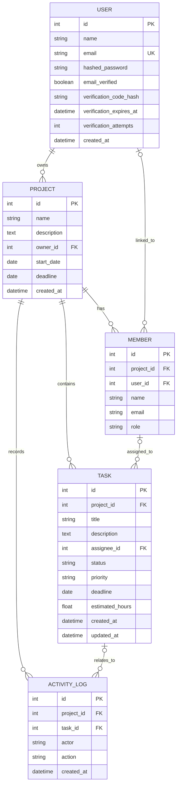

# Entity Relationship Diagram (ERD) Teamly

## 1. Deskripsi

ERD Teamly menggambarkan struktur database yang digunakan untuk mengelola akun pengguna, proyek, anggota tim, tugas, dan aktivitas proyek. ERD ini terdiri dari lima entitas utama, yaitu User, Project, Member, Task, dan ActivityLog.

## 2. Diagram ERD

## 3. Penjelasan Entitas

### 1. User
Menyimpan informasi akun pengguna, seperti nama, email, password yang telah di-hash, status verifikasi email, dan waktu pembuatan akun.

### 2. Project
Menyimpan informasi proyek, seperti nama proyek, deskripsi, pemilik proyek, tanggal mulai, deadline, dan waktu pembuatan.

### 3. Member
Menyimpan informasi anggota proyek, termasuk nama, email, peran, serta hubungan dengan akun pengguna melalui user_id.

### 4. Task
Menyimpan informasi tugas dalam proyek, seperti judul, deskripsi, anggota yang ditugaskan, status, prioritas, deadline, estimasi waktu pengerjaan, dan waktu pembaruan.

### 5. ActivityLog
Menyimpan riwayat aktivitas proyek, seperti pelaku aktivitas, tindakan yang dilakukan, task terkait, dan waktu aktivitas.

## 4. Penjelasan Relasi

1. User dengan Project: Satu pengguna dapat memiliki beberapa proyek, sedangkan setiap proyek memiliki satu pemilik.
2. Project dengan Member: Satu proyek dapat memiliki beberapa anggota, sedangkan setiap anggota terhubung ke satu proyek.
3. User dengan Member: Satu akun pengguna dapat terhubung dengan beberapa data anggota. Hubungan ini bersifat opsional.
4. Project dengan Task: Satu proyek dapat memiliki beberapa tugas, sedangkan setiap tugas berada dalam satu proyek.
5. Member dengan Task: Satu anggota dapat ditugaskan ke beberapa tugas. Penugasan bersifat opsional.
6. Project dengan ActivityLog: Satu proyek dapat memiliki beberapa catatan aktivitas.
7. Task dengan ActivityLog: Satu tugas dapat memiliki beberapa catatan aktivitas. Hubungan ini bersifat opsional.

## 5. Kesimpulan

Berdasarkan ERD tersebut, database Teamly memiliki lima entitas utama yang saling berhubungan untuk mendukung pengelolaan pengguna, proyek, anggota, tugas, dan riwayat aktivitas. Struktur ini menjadi dasar penyimpanan dan pengelolaan data pada aplikasi Teamly.
