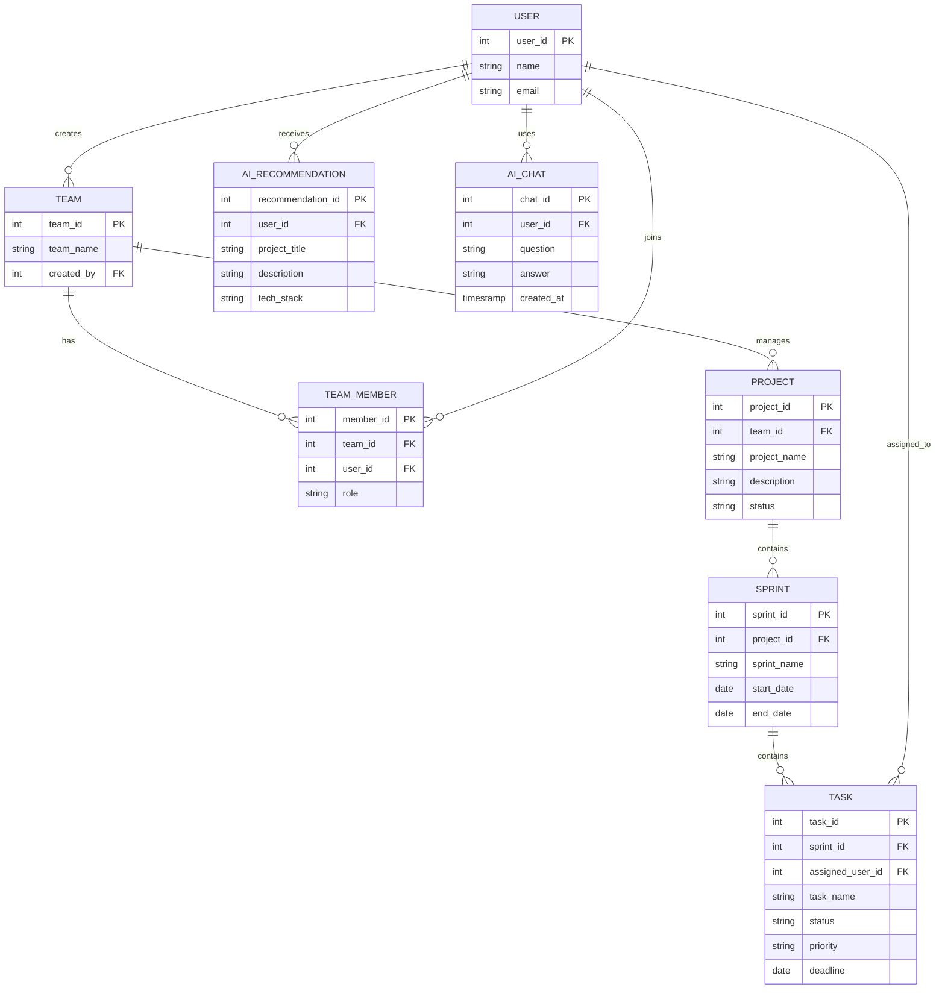

# Entity Relationship Diagram (ERD) Teamly

## 1. Deskripsi

Teamly merupakan aplikasi manajemen proyek dan kolaborasi tim mahasiswa. ERD ini menggambarkan entitas, atribut, serta hubungan antarentitas yang digunakan dalam sistem Teamly.

## 2. Diagram ERD

## 3. Keterangan Entitas

1. USER: Menyimpan informasi akun pengguna.
2. TEAM: Menyimpan informasi kelompok dan pembuat kelompok.
3. TEAM_MEMBER: Menghubungkan pengguna dengan kelompok serta menyimpan peran anggota.
4. PROJECT: Menyimpan informasi proyek yang dikelola oleh kelompok.
5. SPRINT: Mengatur periode pengerjaan proyek.
6. TASK: Menyimpan tugas, anggota yang bertanggung jawab, status, prioritas, dan deadline.
7. AI_RECOMMENDATION: Menyimpan rekomendasi ide proyek yang dihasilkan AI.
8. AI_CHAT: Menyimpan riwayat konsultasi pengguna dengan AI.