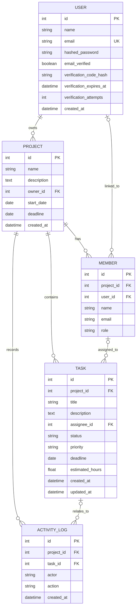

# Entity Relationship Diagram (ERD) Teamly

## 1. Deskripsi

ERD Teamly menggambarkan struktur database yang digunakan untuk mengelola akun pengguna, proyek, anggota proyek, tugas, dan riwayat aktivitas. Berdasarkan implementasi model SQLAlchemy pada `backend/app/models.py`, database Teamly memiliki lima entitas utama, yaitu User, Project, Member, Task, dan ActivityLog.

## 2. Diagram ERD

## 3. Penjelasan Entitas

### 3.1 User

Entitas User menyimpan informasi akun pengguna yang terdaftar pada aplikasi Teamly. Data yang disimpan meliputi identitas pengguna, email, password yang telah di-hash, status verifikasi email, informasi verifikasi, dan waktu pembuatan akun.

### 3.2 Project

Entitas Project menyimpan informasi proyek yang dibuat oleh pengguna. Atributnya meliputi nama proyek, deskripsi, pemilik proyek melalui owner_id, tanggal mulai, deadline, dan waktu pembuatan.

### 3.3 Member

Entitas Member menyimpan informasi anggota yang tergabung dalam suatu proyek. Data yang disimpan meliputi project_id, user_id, nama, email, dan role. Atribut user_id bersifat opsional karena anggota dapat dicatat tanpa harus terhubung langsung dengan akun pengguna.

### 3.4 Task

Entitas Task menyimpan informasi tugas dalam proyek, seperti judul, deskripsi, anggota yang ditugaskan, status, prioritas, deadline, estimasi jam pengerjaan, serta waktu pembuatan dan pembaruan. Atribut assignee_id mengacu pada id anggota di entitas Member.

### 3.5 ActivityLog

Entitas ActivityLog menyimpan riwayat aktivitas yang terjadi pada proyek. Informasi yang dicatat meliputi project_id, task_id jika aktivitas berkaitan dengan tugas tertentu, pelaku aktivitas, deskripsi tindakan, dan waktu aktivitas.

## 4. Penjelasan Relasi

1. **User dengan Project**: Satu pengguna dapat memiliki beberapa proyek. Setiap proyek memiliki satu pemilik yang terhubung melalui owner_id.
2. **Project dengan Member**: Satu proyek dapat memiliki banyak anggota. Setiap data anggota harus terhubung dengan satu proyek.
3. **User dengan Member**: Satu akun pengguna dapat terhubung dengan beberapa data anggota. Hubungan ini bersifat opsional karena user_id pada Member dapat bernilai kosong.
4. **Project dengan Task**: Satu proyek dapat memiliki banyak tugas. Setiap tugas harus terhubung dengan satu proyek.
5. **Member dengan Task**: Satu anggota dapat menerima beberapa tugas. Setiap tugas dapat memiliki satu anggota yang ditugaskan atau tidak memiliki penanggung jawab.
6. **Project dengan ActivityLog**: Satu proyek dapat memiliki banyak catatan aktivitas. Setiap catatan aktivitas harus terhubung dengan satu proyek.
7. **Task dengan ActivityLog**: Satu tugas dapat memiliki beberapa catatan aktivitas. Catatan aktivitas juga dapat dibuat tanpa terhubung dengan task tertentu.

## 5. Keterangan Primary Key dan Foreign Key

- **Primary Key (PK)** merupakan atribut yang menjadi identitas unik setiap data pada tabel.
- **Foreign Key (FK)** merupakan atribut yang menghubungkan suatu tabel dengan tabel lainnya.
- **Unique (UK)** menunjukkan bahwa nilai atribut harus bersifat unik, seperti email pada entitas User.

Foreign Key yang digunakan dalam database Teamly:

| Entitas | Atribut FK | Referensi |
|---|---|---|
| Project | owner_id | User.id |
| Member | project_id | Project.id |
| Member | user_id | User.id |
| Task | project_id | Project.id |
| Task | assignee_id | Member.id |
| ActivityLog | project_id | Project.id |
| ActivityLog | task_id | Task.id |

## 6. Catatan Implementasi

ERD ini disusun berdasarkan model database pada `backend/app/models.py`. Fitur AI Chat dan AI Project Idea Generator tersedia melalui endpoint backend, tetapi tidak memiliki tabel tersendiri pada model database saat ini.

Komentar tugas yang dikelola di frontend juga belum didefinisikan sebagai entitas database tersendiri.

## 7. Kesimpulan

Database Teamly terdiri dari lima entitas utama yang saling berhubungan untuk mendukung pengelolaan akun pengguna, proyek, anggota, tugas, dan riwayat aktivitas. Relasi antarentitas menggunakan Primary Key dan Foreign Key agar pengelolaan data proyek dapat dilakukan secara terstruktur.
