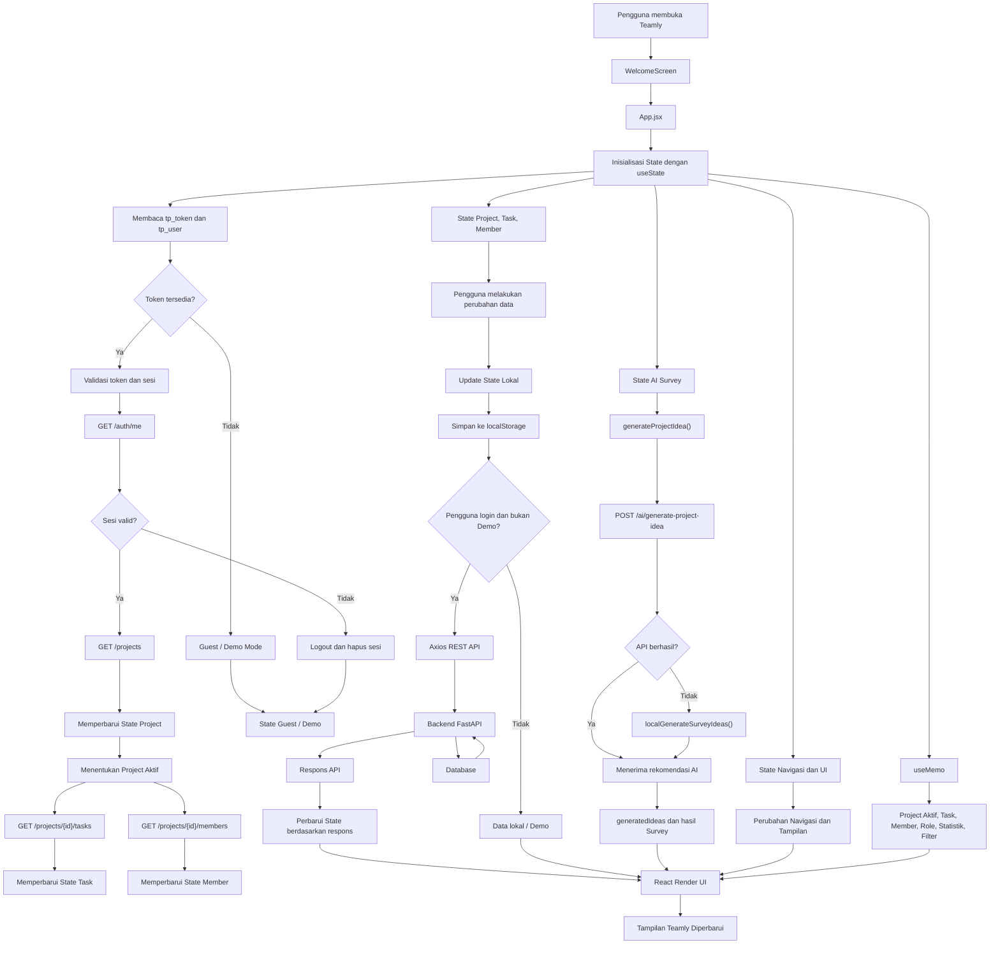

# State Management Diagram Teamly

## 1. Deskripsi

State Management pada aplikasi Teamly menggunakan React Hooks untuk mengelola data dan perubahan tampilan aplikasi. Implementasi utamanya terdapat pada `frontend/src/App.jsx` dan `frontend/src/AuthPage.jsx`.

React Hooks yang digunakan meliputi useState, useEffect, dan useMemo. Aplikasi juga menggunakan Axios untuk komunikasi dengan backend FastAPI serta localStorage untuk menyimpan token autentikasi dan data aplikasi tertentu.

Pengelolaan data dilakukan melalui state lokal terlebih dahulu. Untuk beberapa operasi, aplikasi kemudian mencoba menyinkronkan perubahan tersebut ke backend apabila pengguna telah login dan bukan menggunakan Demo Mode.

## 2. Teknologi yang Digunakan

### 2.1 useState

useState digunakan untuk menyimpan dan mengubah data aplikasi, seperti:

- Token dan informasi pengguna.
- Status login dan Demo Mode.
- Data project, task, dan member.
- Project yang sedang aktif.
- Navigasi halaman dan tampilan Kanban atau List.
- Jawaban AI Survey dan hasil rekomendasi ide.
- Modal, pencarian, filter, dan notifikasi.

Pada AuthPage.jsx, useState juga digunakan untuk mengelola input email, password, nama, kode verifikasi, status loading, dan pesan kesalahan.

### 2.2 useEffect

useEffect digunakan untuk menjalankan proses berdasarkan perubahan state atau ketika komponen pertama kali dimuat, antara lain:

- Memeriksa dan memvalidasi sesi pengguna.
- Mengambil data project dari backend.
- Mengambil task dan member berdasarkan project aktif.
- Menyimpan data project, task, dan member ke localStorage.
- Memperbarui penyimpanan data demo.
- Menjalankan transisi otomatis dari Welcome Screen ke Workspace.

### 2.3 useMemo

useMemo digunakan untuk menghasilkan data turunan dari state utama agar perhitungan tidak dilakukan ulang ketika dependensinya tidak berubah.

Contoh penggunaan:

- Menentukan project yang sedang aktif.
- Mengambil daftar task pada project aktif.
- Mengambil daftar member pada project aktif.
- Menentukan role pengguna.
- Menentukan task yang dapat dilihat oleh anggota.
- Menghitung statistik, pencarian, filter, dan task yang mendekati deadline.

### 2.4 Axios

Axios digunakan untuk menghubungkan frontend dengan backend FastAPI melalui REST API. Token JWT ditambahkan secara otomatis pada header Authorization melalui request interceptor di `api.js` apabila token tersedia.

### 2.5 localStorage

localStorage digunakan untuk menyimpan data tertentu agar tetap tersedia ketika halaman dimuat ulang.

Beberapa key yang digunakan antara lain:

| Key | Fungsi |
|---|---|
| tp_token | Menyimpan token autentikasi |
| tp_user | Menyimpan informasi pengguna |
| tp_saved_projects | Menyimpan project pengguna yang login |
| tp_saved_tasks | Menyimpan task pengguna yang login |
| tp_saved_members | Menyimpan member pengguna yang login |
| tp_saved_active_pid | Menyimpan ID project aktif |
| tp_demo_projects | Menyimpan project pada Demo Mode |
| tp_demo_tasks | Menyimpan task pada Demo Mode |
| tp_demo_members | Menyimpan member pada Demo Mode |
| tp_demo_active_pid | Menyimpan ID project aktif pada Demo Mode |
| tp_notifications | Menyimpan notifikasi lokal |
| tp_shared_data | Menyimpan data project, member, dan task untuk mekanisme berbagi lokal |

## 3. Diagram State Management



## 4. Alur Pengelolaan State

### 4.1 Inisialisasi Aplikasi

Ketika aplikasi dibuka, WelcomeScreen menampilkan halaman pembuka dan secara otomatis berpindah ke Workspace setelah sekitar 1,5 detik. Selanjutnya, App.jsx menginisialisasi state menggunakan useState.

Aplikasi membaca token dan informasi pengguna dari localStorage untuk menentukan apakah pengguna memiliki sesi login atau menggunakan Guest/Demo Mode.

### 4.2 Pengelolaan Autentikasi

Proses autentikasi dikelola oleh AuthPage.jsx dan App.jsx.

AuthPage menggunakan state untuk mengelola form login, registrasi, kode verifikasi email, loading, dan pesan kesalahan.

Proses autentikasi berkomunikasi dengan backend melalui endpoint:

- POST /auth/login
- POST /auth/register
- POST /auth/verify-email
- POST /auth/verification/resend

Setelah autentikasi berhasil, token JWT dan informasi pengguna disimpan ke localStorage. App.jsx kemudian memperbarui state token dan user.

### 4.3 Validasi Sesi dan Pengambilan Data

Ketika token tersedia, useEffect pada App.jsx memeriksa format token dan memanggil endpoint GET /auth/me.

Jika sesi valid, aplikasi mengambil daftar project melalui GET /projects. Setelah project aktif ditentukan, aplikasi mengambil data task dan member melalui:

- GET /projects/{id}/tasks
- GET /projects/{id}/members

Respons backend kemudian digunakan untuk memperbarui state project, task, dan member.

Jika sesi tidak valid, aplikasi menjalankan proses logout dan menghapus token serta informasi pengguna dari localStorage.

### 4.4 Pengelolaan Project, Task, dan Member

Data project, task, dan member disimpan menggunakan useState.

Ketika pengguna melakukan perubahan, aplikasi memperbarui state lokal terlebih dahulu. Pada operasi yang terhubung dengan backend, Axios kemudian mencoba mengirim perubahan ke FastAPI.

Beberapa endpoint yang digunakan adalah:

- POST /projects
- DELETE /projects/{id}
- POST /projects/{id}/tasks
- PATCH /tasks/{id}
- DELETE /tasks/{id}
- POST /projects/{id}/members
- DELETE /projects/{id}/members/{member_id}

Jika pengguna berada dalam Demo Mode, perubahan dikelola melalui penyimpanan lokal tanpa sinkronisasi ke backend.

### 4.5 Penyimpanan dan Sinkronisasi Data

useEffect digunakan untuk menyimpan perubahan state ke localStorage.

Pada pengguna yang login, data disimpan menggunakan key tp_saved_projects, tp_saved_tasks, tp_saved_members, dan tp_saved_active_pid.

Pada Demo Mode, aplikasi menggunakan key tp_demo_projects, tp_demo_tasks, tp_demo_members, dan tp_demo_active_pid.

Aplikasi juga menggunakan tp_shared_data untuk mekanisme berbagi data project, member, dan task secara lokal pada browser yang sama.

### 4.6 Pengelolaan AI Survey

AI Survey menggunakan beberapa state, yaitu surveyStep, selectedDomain, selectedPlatform, selectedTeamSize, selectedDuration, selectedDifficulty, selectedKeyFeature, generatedIdeas, dan isAnalyzingIdeas.

Ketika pengguna menyelesaikan survey, fungsi generateProjectIdea() mencoba mengirim data ke endpoint POST /ai/generate-project-idea.

Jika backend tidak tersedia atau permintaan gagal, aplikasi menggunakan localGenerateSurveyIdeas() sebagai generator alternatif di frontend.

Hasil rekomendasi disimpan ke generatedIdeas dan ditampilkan pada halaman hasil survey.

Ketika pengguna memilih salah satu ide untuk diterapkan menjadi project, aplikasi memeriksa autentikasi terlebih dahulu. Pembuatan project dan task kemudian dilakukan melalui state lokal atau backend sesuai mode pengguna.

### 4.7 Pengelolaan Komentar dan Notifikasi

Komentar tugas dan notifikasi pada frontend dikelola menggunakan useState.

Komentar tugas disimpan pada properti comments dalam state task dan diperbarui secara lokal. Pada implementasi saat ini, komentar tersebut belum memiliki tabel tersendiri di database dan belum dikirim melalui endpoint backend khusus.

Notifikasi lokal disimpan pada key tp_notifications. Sementara itu, backend juga menyediakan ActivityLog untuk mencatat aktivitas pembuatan dan perubahan task.

### 4.8 Penggunaan useMemo

useMemo digunakan untuk menghasilkan informasi turunan dari state utama, seperti project aktif, task dan member pada project aktif, role pengguna, task yang dapat dilihat anggota, statistik project, hasil pencarian, filter task, dan daftar task yang mendekati deadline.

Dengan demikian, data turunan dapat diperbarui berdasarkan perubahan state yang menjadi dependensinya.

## 5. Endpoint Backend yang Tersedia

Selain endpoint yang sudah digunakan oleh frontend, backend Teamly juga menyediakan beberapa endpoint berikut:

| Endpoint | Fungsi |
|---|---|
| GET /projects/{id}/notifications | Mengambil riwayat aktivitas project |
| GET /projects/{id}/analytics | Mengambil statistik dan beban kerja anggota |
| GET /projects/{id}/insights | Menghasilkan analisis project menggunakan AI |
| POST /ai/chat | Mengirim pertanyaan pengguna ke AI berdasarkan data project |
| GET /projects/{id}/report | Menghasilkan ringkasan laporan project |

Endpoint tersebut tersedia pada `backend/app/main.py`. Namun, endpoint AI Chat, Analytics, Insights, dan Report belum terlihat dipanggil oleh `App.jsx` pada kode frontend yang diperiksa.

## 6. Kesimpulan

State Management Teamly menggunakan React Hooks sebagai mekanisme utama dalam mengelola data dan tampilan aplikasi. useState digunakan untuk menyimpan dan memperbarui state, useEffect digunakan untuk menjalankan proses inisialisasi, validasi sesi, pengambilan data, dan penyimpanan lokal, sedangkan useMemo digunakan untuk menghasilkan data turunan.

Axios menghubungkan frontend dengan backend FastAPI, sedangkan localStorage membantu mempertahankan data tertentu pada browser. Kombinasi tersebut mendukung pengelolaan autentikasi, project, task, member, navigasi, serta AI Survey pada aplikasi Teamly.
```
