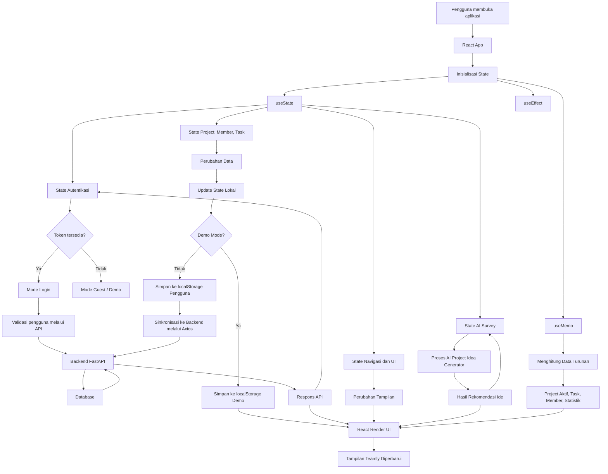

# State Management Diagram Teamly

## 1. Deskripsi

State Management pada aplikasi Teamly menggunakan React Hooks, yaitu useState, useEffect, dan useMemo. State Management digunakan untuk mengelola perubahan data dan tampilan aplikasi, seperti autentikasi pengguna, project, anggota, task, navigasi, serta proses AI Project Idea Generator.

Aplikasi menggunakan Axios untuk komunikasi dengan backend FastAPI dan localStorage untuk menyimpan token serta data tertentu agar tetap tersedia setelah halaman dimuat ulang.

## 2. Teknologi yang Digunakan

1. **useState**: Mengelola state yang dapat berubah, seperti data project, task, anggota, autentikasi, dan tampilan halaman.
2. **useEffect**: Menjalankan proses tertentu ketika komponen dimuat atau ketika nilai state yang menjadi dependensinya berubah.
3. **useMemo**: Menghitung dan menyimpan hasil turunan dari state, seperti project aktif, daftar task, anggota, dan statistik.
4. **Axios**: Menghubungkan frontend dengan backend FastAPI melalui API.
5. **localStorage**: Menyimpan token autentikasi, informasi pengguna, serta data project, task, dan anggota.

## 3. Diagram State Management

## 4. Alur Pengelolaan State

### 4.1 Inisialisasi State

Ketika aplikasi dibuka, React menginisialisasi state menggunakan useState. Data token dan informasi pengguna diperiksa melalui localStorage untuk menentukan kondisi autentikasi pengguna.

### 4.2 Pengelolaan Autentikasi

State autentikasi mengelola token, informasi pengguna, dan kondisi Demo Mode. Proses login, registrasi, serta verifikasi email dilakukan melalui API backend FastAPI.

### 4.3 Pengelolaan Project dan Task

State project, anggota, dan task digunakan untuk menyimpan serta memperbarui data utama aplikasi. Ketika pengguna menambahkan, mengubah, atau menghapus task, perubahan state lokal dilakukan terlebih dahulu. Jika pengguna menggunakan akun dan bukan Demo Mode, aplikasi juga mencoba mengirim perubahan tersebut ke backend.

### 4.4 Pengelolaan Navigasi dan Tampilan

State navigasi mengatur halaman yang sedang dibuka, seperti Dashboard, AI Generator, Tasks, dan Team. State UI lainnya digunakan untuk mengelola modal, pencarian, filter, notifikasi, serta tampilan Kanban atau List.

### 4.5 Pengelolaan AI Survey

State AI Survey menyimpan jawaban pengguna, seperti domain, platform, ukuran tim, durasi, tingkat kesulitan, dan fitur utama. Setelah analisis selesai, hasil rekomendasi ide disimpan ke state generatedIdeas dan ditampilkan kepada pengguna.

### 4.6 Penggunaan useMemo

useMemo digunakan untuk menghasilkan data turunan dari state utama, seperti project aktif, task pada project yang dipilih, anggota project, role pengguna, dan statistik tugas.

### 4.7 Penyimpanan Data

useEffect digunakan untuk menyimpan data tertentu ke localStorage ketika state yang berkaitan mengalami perubahan. Pada mode akun, aplikasi juga mencoba melakukan sinkronisasi data dengan backend FastAPI.

## 5. Kesimpulan

State Management Teamly menggunakan React Hooks sebagai mekanisme utama untuk mengelola perubahan data dan tampilan aplikasi. useState digunakan untuk menyimpan state, useEffect digunakan untuk menjalankan proses dan sinkronisasi data, sedangkan useMemo digunakan untuk menghasilkan data turunan.

Kombinasi React Hooks, Axios, localStorage, dan FastAPI membantu aplikasi mengelola data pengguna, project, anggota, task, serta fitur AI secara terstruktur.
